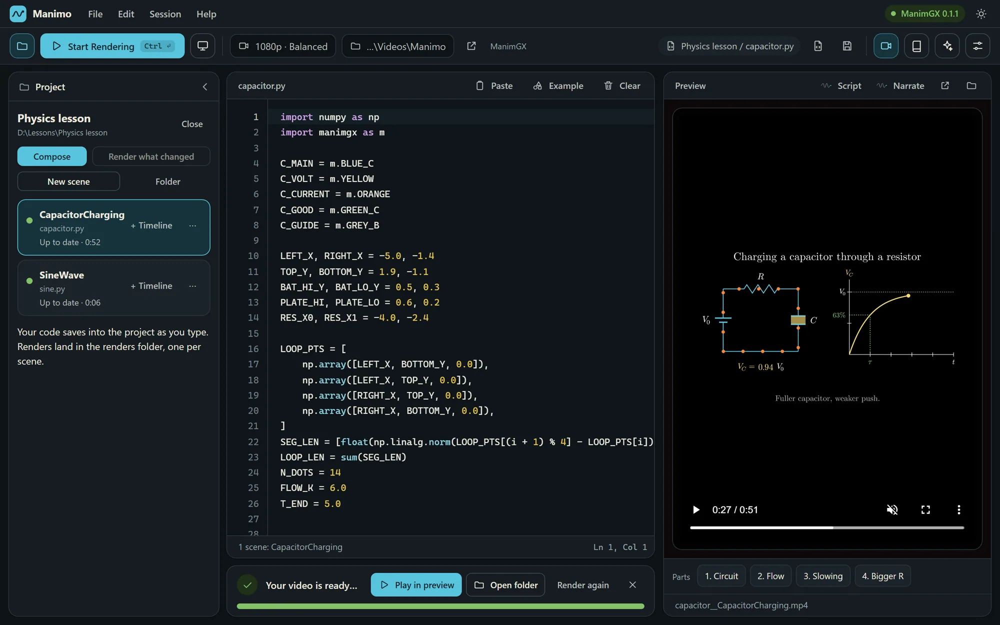
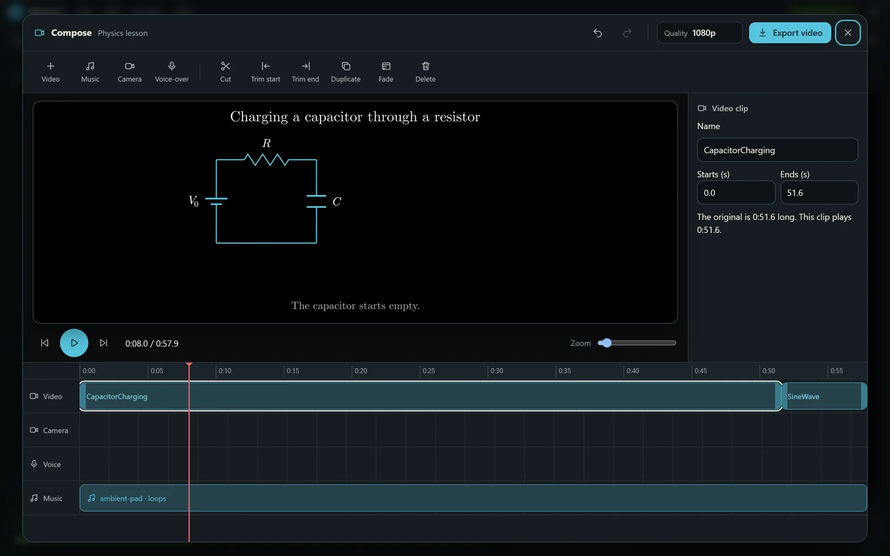
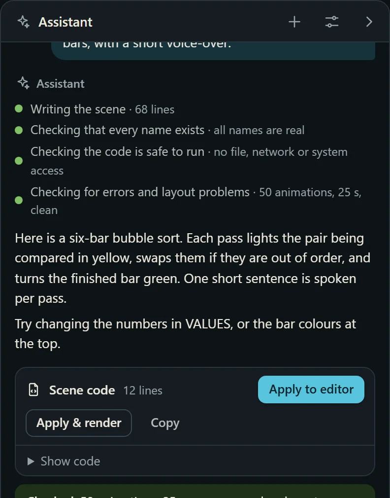
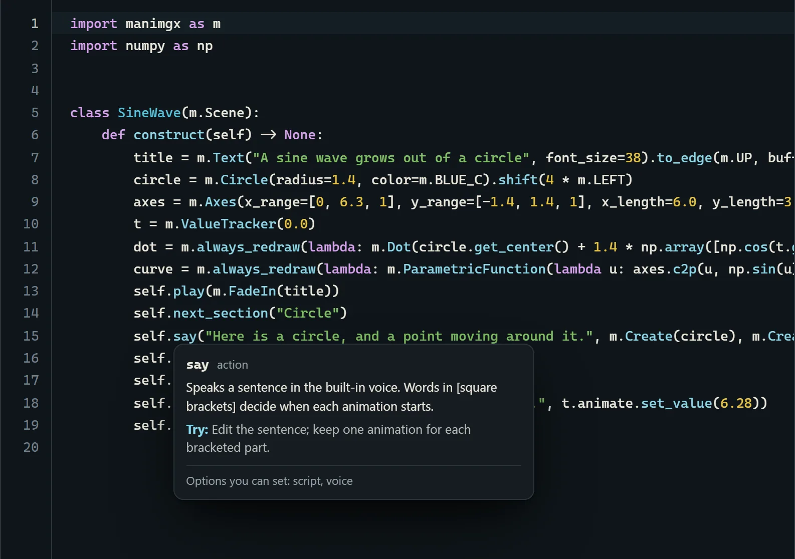

# Manimo

**Math, in motion.** Manimo is a Windows desktop app that turns animation code into narrated lesson videos, on your own computer, offline, with no account. It is made for teachers, students and anyone who wants moving diagrams without learning Python.

Write or paste an animation, press **Start Rendering**, watch it in the preview, then join your scenes into one finished video with narration, music and captions.



## What it does

- **Render.** A ManimGX (Rust, GPU) engine draws Manim-style animations fast. Manim Community Edition is supported too, with an optional offline LaTeX bundle.
- **Any shape.** Wide 16:9, tall 9:16, square, 4:3 and 3:4, at 480p to 4K. "Same as my code" follows the size a scene asks for.
- **AI assistant.** Describe an idea in plain words. The assistant writes the code, checks it for errors and overlapping text, renders a test, and fixes what it finds. Use a local Claude Code agent, an Anthropic API key, or any OpenAI-compatible service. A Lesson prompt builder and library help you ask well.
- **Narration.** Four offline voices (Adam, Echo, Nicole, Lewis) powered by Kokoro, a Narrate button that records your own voice and camera, and script export with timestamps.
- **Projects.** A `.mo` project keeps scenes, renders and your timeline together, and knows which scenes are out of date.
- **Compose.** A built-in video editor: cut, trim, fade, background music, camera overlay, voice-over, "Speak text", cover pictures, and export with chapters and subtitles. Share presets set the size for YouTube, Reels, Instagram or WhatsApp, and captions can be burned onto the picture.
- **Edit video.** Open any single finished video in Compose, with or without a project.
- **My videos.** Browse everything you have rendered, with cover pictures.
- **Learn as you go.** Hover any code to see what it does, plus a Learn dialog and a command guide.
- **Four looks.** Chalkboard, Blueprint, Paper (light) and Mint.

| Compose editor | AI assistant | Hover help |
|---|---|---|
|  |  |  |

## Install

Download the latest `Manimo-Setup-<version>.exe` from the [Releases](../../releases) page and run it. It installs for the current user only (no administrator rights) and works fully offline.

The installer is signed with a self-made test certificate for now, so Windows SmartScreen may show "Windows protected your PC" on first run: choose **More info**, then **Run anyway**. A real code-signing certificate is planned.

Silent install: `Manimo-Setup-<version>.exe /VERYSILENT /SUPPRESSMSGBOXES`.

## Run from source

Manimo is Python 3.13, a standard-library HTTP server and a plain JavaScript page; there is no web framework.

```powershell
# 1. Python 3.13 with the packages the app needs
python -m pip install -r app\requirements.txt

# 2. The offline voice model (about 115 MB, not stored in the repository)
powershell -ExecutionPolicy Bypass -File tools\Get-Models.ps1

# 3. Start the desktop window
python app\desktop.py
```

`python app\server.py --no-window` runs only the local server (useful for browser testing).

## Build the installer

You need [Inno Setup](https://jrsoftware.org/isinfo.php) 7 and an internet connection for the first build (it downloads and caches the Python runtime and wheels).

```powershell
powershell -NoProfile -ExecutionPolicy Bypass -File installer\Build-Manimo.ps1 -TestSign
```

The result is `dist\Manimo-Setup-<version>.exe`. See [installer/README.md](installer/README.md) for the optional Manim CE + LaTeX component and the build details.

## Tests

```powershell
python -m unittest discover -s tests -t .
```

66 fast tests run in about a second. Real renders are skipped unless you set `MANIMO_SLOW=1`. See [tests/README.md](tests/README.md).

## How it is built

| Part | Choice |
|---|---|
| Window | pywebview (WebView2) |
| Backend | Python standard-library `ThreadingHTTPServer` on `127.0.0.1`, token and Host checks, exclusive port bind |
| Front end | Plain HTML, CSS and JavaScript, CodeMirror 6 for the editor |
| Engines | ManimGX 0.1.1 (default), Manim Community Edition (optional) |
| Video | ffmpeg (from `imageio-ffmpeg`) |
| Voices | Kokoro int8 ONNX model, offline |
| Installer | Inno Setup |

More in [docs/ARCHITECTURE.md](docs/ARCHITECTURE.md).

## Repository layout

```
app/         the application (server, project and Compose logic, front end, AI helper and skill pack)
editor/      source for the bundled code editor (built into app/vendor/editor.js)
installer/   Inno Setup script, build script, notices
site/        the product landing page
web/         a static in-browser demo
skills/      the Manimo animator skill pack
tests/       automatic tests
tools/       helper scripts (voice model download, skill packaging)
```

## Credits and thanks

Built by **Mathan Kumar P** (Coimbatore, Tamil Nadu) with **Claude**, an AI assistant from Anthropic.

With thanks to the **ManimGX** team at Academa and to the developers of **Manim Community Edition**, whose work makes Manimo possible. Manim itself began as Grant Sanderson's animation library for 3Blue1Brown. Thanks also to the authors of Kokoro, ffmpeg, CodeMirror, TeX Live and the other open-source projects listed in [installer/THIRD-PARTY-NOTICES.txt](installer/THIRD-PARTY-NOTICES.txt).

## Licence

Manimo's own code is released under the [MIT licence](LICENSE). The installer bundles third-party software, each under its own licence; see [installer/THIRD-PARTY-NOTICES.txt](installer/THIRD-PARTY-NOTICES.txt).

## Contributing and reporting problems

See [CONTRIBUTING.md](CONTRIBUTING.md). In the app, **Help, Report a problem** builds a report you can send by email, or open an [issue](../../issues/new/choose) here.
